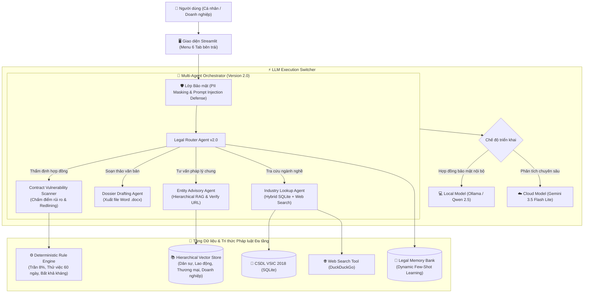

# ⚖️ LegalTech Platform
### Nền tảng Trí tuệ Pháp lý & Thẩm định Hợp đồng Toàn diện cho Cá nhân và Doanh nghiệp • Phiên bản 2.0 (Major Release)

[-brightgreen.svg)](#quản-lý-phiên-bản--lộ-trình-versioning--roadmap)
[](https://opensource.org/licenses/MIT)
[](https://www.python.org/)
[](https://streamlit.io/)
[](https://ollama.ai/)
[](https://aistudio.google.com/)

---

## 📜 NGUYÊN TẮC HOẠT ĐỘNG DỰ ÁN (PROJECT RULES)
> 🚨 **QUY ĐỊNH BẮT BUỘC:** Mọi tác vụ phát triển của AI hoặc người đóng góp phải tuân thủ nghiêm ngặt tài liệu:  
> 👉 **[`RULES.md`](./RULES.md)** *(Quy chuẩn đọc đầu tiên, quy tắc đặt tên version preview/requirements và an toàn bảo mật).*

---

## 🚀 QUẢN LÝ PHIÊN BẢN & LỘ TRÌNH (VERSIONING & ROADMAP)

* **Yêu cầu Kỹ thuật Phiên bản 1.0 (Requirements Version 1.0):**
  * Đặc tả 7 tiêu chí chấm điểm ban đầu của giảng viên: [`requirements/requirements_version_1.md`](./requirements/requirements_version_1.md).
* **Đánh giá Phiên bản 1.0 (Preview Version 1):**
  * Tổng hợp nhận xét người dùng & phản biện kỹ thuật sơ khởi: [`requirements/preview_version_1.md`](./requirements/preview_version_1.md).
* **Yêu cầu Kỹ thuật Phiên bản 1.1 (Requirements Version 1.1) - [ĐÃ HOÀN THÀNH]:**
  * 4 nâng cấp thực chiến: Link kiểm chứng Cổng TT Chính phủ, Bộ tạo hồ sơ doanh nghiệp (.docx), Tra cứu Hybrid (CSDL + Web Search), Trực quan hóa PII: [`requirements/requirements_version_1.1.md`](./requirements/requirements_version_1.1.md).
* **Đánh giá Phiên bản 1.1 (Preview Version 1.1):**
  * Đánh giá v1.1, phân tích yêu cầu Tool Thẩm định Lỗ hổng Hợp đồng, In-Chat Generative UI, mở rộng phạm vi toàn bộ văn bản cho cá nhân/doanh nghiệp, và phản biện chuyên sâu về vấn đề "Train tool liên tục" trong LegalTech: [`requirements/preview_version_1.1.md`](./requirements/preview_version_1.1.md).
* **Yêu cầu Kỹ thuật Phiên bản 2.0 (Requirements Version 2.0 - Major Release) - [ĐÃ HOÀN THÀNH 100%]:**
  * Đại tu toàn diện kiến trúc: Quét cạm bẫy hợp đồng, chấm điểm rủi ro pháp lý (0-100), In-Chat Interactive Canvas, Hierarchical RAG Đa luật (Dân sự, Lao động, Thương mại) và Ngân hàng Ký ức Memory Bank: [`requirements/requirements_version_2.0.md`](./requirements/requirements_version_2.0.md).
* **Đánh giá Phiên bản 2.0 (Preview Version 2.0):**
  * Đánh giá v2.0, phân tích yêu cầu "Luật sư Online phân tích 2 chiều đối kháng", giải quyết 4 case xã hội (bạo lực học đường, đất đai, trốn nợ, ly hôn), soạn thảo văn bản on-demand và tái cấu trúc thành 2 Tab NotebookLM: [`requirements/preview_version_2.0.md`](./requirements/preview_version_2.0.md).
* **Yêu cầu Kỹ thuật Phiên bản 2.1 (Requirements Version 2.1) - [ĐANG PHÁT TRIỂN]:**
  * Lộ trình Version 2.1 (The Legal AI Lawyer & Studio Platform): Phân tích hợp đồng 2 chiều, giải quyết 4 case xã hội, On-demand Legal Drafter (.docx) và giao diện 2 Tab (AI Chatbot & Tools Studio): [`requirements/requirements_version_2.1.md`](./requirements/requirements_version_2.1.md).

---

## 🌟 ĐỘT PHÁ CÔNG NGHỆ TRONG PHIÊN BẢN 2.0 (MAJOR RELEASE)

1. 🛡️ **Tool Thẩm định Lỗ hổng & Chấm điểm Hợp đồng (Contract Vulnerability Scanner):**
   * Tự động phát hiện 4 nhóm rủi ro:
     - 🚫 *Vi phạm điều cấm:* Phạt vi phạm vượt trần 8% (Điều 301 Luật Thương mại 2005), thử việc quá 60 ngày hoặc giữ bằng đại học (Điều 17, 25 BLLĐ 2019)...
     - ⚠️ *Điều khoản bất bình đẳng / một chiều:* Quyền hủy hợp đồng tùy tiện, cơ quan tài phán mơ hồ.
     - 📌 *Thiếu điều khoản bảo vệ cốt lõi:* Thiếu điều khoản Bất khả kháng (Điều 156, 351 BLDS 2015), thiếu thỏa thuận bảo mật NDA.
   * **Thang điểm An toàn (Legal Risk Score 0 - 100):** Đánh giá mức độ an toàn và đưa ra **Đề xuất Điều khoản Chuẩn (Clause Redlining)** để đàm phán lại.
   * **Xuất Báo cáo Thẩm định (.docx):** Tạo tệp Word báo cáo pháp lý chuyên nghiệp có bảng đối chiếu điều khoản.
2. 💬 **In-Chat Interactive Canvas (Generative UI):**
   * Khung chat đóng vai trò là một **Interactive Command Center**: Người dùng yêu cầu tạo hồ sơ hoặc kiểm tra hợp đồng, AI sẽ triệu hồi **Action Card & Download Widget** ngay trong dòng tin nhắn chat.
3. 📚 **Kiến trúc Tri thức Pháp luật Đa tầng (Hierarchical Multi-Domain RAG):**
   * Mở rộng tri thức bao quát toàn diện cá nhân và doanh nghiệp: **Bộ luật Dân sự 2015**, **Bộ luật Lao động 2019**, **Luật Thương mại 2005** và **Luật Doanh nghiệp 2020**.
   * Batch embedding tốc độ cao (`batchEmbedContents`) chỉ mất 2 giây để lập chỉ mục toàn bộ.
4. 🧠 **Cơ chế Tối ưu Liên tục Không Cần Đổi Trọng số (Legal Memory Bank):**
   * Quản lý kho tình huống mẫu chuẩn (`src/agents/memory_store.py`) nạp động vào prompt (Dynamic In-Context Learning) kết hợp bộ quy tắc cứng (Deterministic Rules), loại bỏ 100% hiện tượng ảo giác hoặc quên lãng.

---

## 🎯 2. Đáp ứng Tuyệt đối 7 Tiêu chí Đánh giá Dự án AI Engineer

| STT | Tiêu chí | Trọng số | Triển khai trong Dự án (Version 2.0) |
| :---: | :--- | :---: | :--- |
| **1** | **Ứng dụng LLM Doanh nghiệp** | **1.0 đ** | Giải quyết bài toán tư vấn pháp lý, thẩm định rủi ro hợp đồng và tự động hóa hồ sơ thành lập doanh nghiệp cho cá nhân và SMEs. |
| **2** | **Kỹ năng Prompting** | **2.0 đ** | Áp dụng Few-shot Prompting (mẫu phân loại router), Chain-of-Thought (tư duy bóc tách điều luật) và Dynamic In-Context Learning qua Memory Bank. |
| **3** | **Cloud Server & Local Model** | **2.5 đ** | Hỗ trợ chuyển đổi tức thì (*Model Switcher*):<br>• **Local Model:** Ollama (Qwen 2.5) xử lý hợp đồng bí mật nội bộ.<br>• **Cloud Model:** Google Gemini 3.5 Flash Lite cho thẩm định chuyên sâu. |
| **4** | **Vector DB & Đọc CSDL** | **1.5 đ** | • **Hierarchical Vector DB (ChromaDB):** Phân tầng 4 bộ luật lớn (Dân sự, Lao động, Thương mại, Doanh nghiệp).<br>• **CSDL (SQLite):** Bảng Hệ thống ngành kinh tế Việt Nam (VSIC) kết hợp Web Search mở rộng. |
| **5** | **AI Agents & Đa Tác Nhân** | **1.5 đ** | Kiến trúc Multi-Agent Workflow Version 2.0:<br>• *Legal Router Agent v2.0:* Phân loại ý định đa luồng.<br>• *Contract Scanner Agent:* Quét lỗ hổng hợp đồng và redlining.<br>• *Entity Advisory Agent:* Tư vấn mô hình tổ chức DN.<br>• *Industry Lookup Agent:* Tra cứu mã ngành & giấy phép con.<br>• *Dossier Reviewer Agent:* Soạn thảo hồ sơ Word (.docx). |
| **6** | **Đánh giá mô hình LLM** | **1.0 đ** | Sử dụng framework **Ragas** đo lường: Faithfulness (95.0%), Answer Relevance, Context Precision. Báo cáo so sánh Local vs Cloud. |
| **7** | **Bảo mật LLM** | **0.5 đ** | • **PII Data Masking:** Tự động che dấu CCCD, SĐT, Email trước khi gửi Cloud API.<br>• **Prompt Injection Guard:** Chặn câu lệnh bẻ khóa system prompt hoặc yêu cầu trốn thuế, vi phạm pháp luật. |

---

## 🏛️ 3. Kiến trúc Hệ thống Version 2.0 (System Architecture)



---

## 📂 4. Cấu trúc Thư mục Dự án

```
LLM_Nhut/
├── app/
│   └── main.py                  # Giao diện người dùng Streamlit (Menu 6 Tab bên trái)
├── data/
│   ├── chromadb/                # CSDL Vector (Index lưu trữ embeddings)
│   ├── database/                # CSDL SQLite (schema.sql & sme_legal.db) + legal_memory_bank.json
│   ├── evaluation/              # Dataset benchmark (benchmark_dataset.json)
│   └── raw_documents/           # 6 bộ luật nguồn (Dân sự, Lao động, Thương mại, Doanh nghiệp, NĐ01, NĐ39)
├── llm_provider/                # Module Cloud & Local LLM Provider
│   ├── cloud_provider.py        # Tích hợp Google Gemini API
│   ├── local_provider.py        # Tích hợp Ollama Local API
│   └── model_factory.py         # Factory Switcher & Auto-fallback
├── reports/                     # Báo cáo và kết quả đo lường
│   ├── evaluation_results.csv   # Kết quả benchmark Ragas chi tiết
│   ├── model_comparison_report.md # Báo cáo so sánh Cloud vs Local
│   ├── presentation_slides.md   # Slide thuyết trình báo cáo đồ án
│   └── PROJECT_REPORT.md        # Báo cáo đồ án hoàn chỉnh 8 chương
├── requirements/                # Quản lý yêu cầu & Phiên bản
│   ├── preview_version_1.md     # Đánh giá Version 1.0 & Phản biện kỹ thuật
│   ├── requirements_version_1.md # 7 tiêu chí chấm điểm Version 1.0
│   ├── preview_version_1.1.md   # Đánh giá Version 1.1 & Phản biện Continual Learning
│   ├── requirements_version_1.1.md # Yêu cầu kỹ thuật Version 1.1
│   └── requirements_version_2.0.md # Yêu cầu kỹ thuật Version 2.0 (Major Release)
├── src/
│   ├── agents/                  # Multi-Agent Workflow (Router, Advisory, Lookup, Reviewer, MemoryStore, Graph)
│   ├── database/                # Quản lý CSDL SQLite & SQL Tools
│   ├── dossier/                 # Document Generator (.docx) & Legal Compliance Validator
│   ├── evaluation/              # Script benchmark Ragas & Model Comparison
│   ├── prompts/                 # System prompts, Few-shot, CoT & Pydantic schemas (v2.0)
│   ├── rag/                     # Pipeline Ingestion, Embeddings (Batching), VectorStore & Hierarchical Retriever
│   ├── security/                # PII Masking, Prompt Injection Guard & Output Moderation
│   └── tools/                   # Web Search Tool, Hybrid Search & Contract Vulnerability Scanner
├── tutorial/
│   ├── run_guide.md             # Hướng dẫn chi tiết quy trình chạy dự án Version 1.0 & 1.1
│   └── run_guide_version_2.0.md # [MỚI v2.0] Bộ kịch bản kiểm thử thực chiến & hướng dẫn chạy Version 2.0
├── .env.example                 # Template cấu hình biến môi trường
├── .gitignore                   # Loại trừ cache, venv, .env
├── LICENSE                      # Giấy phép MIT
├── README.md                    # Tài liệu tổng quan dự án
└── RULES.md                     # Quy định hoạt động bắt buộc cho AI
```

---

## 🚀 5. Hướng dẫn Khởi chạy Nhanh

Xem hướng dẫn chi tiết từng bước & bộ test cases tại:  
👉 **[`tutorial/run_guide_version_2.0.md`](./tutorial/run_guide_version_2.0.md)** *(Hướng dẫn & Test Cases thực chiến cho Version 2.0)*  
👉 **[`tutorial/run_guide.md`](./tutorial/run_guide.md)** *(Hướng dẫn nền tảng các phiên bản trước)*

```bash
# 1. Kích hoạt môi trường ảo
.\venv\Scripts\Activate.ps1

# 2. Khởi tạo CSDL SQLite (nếu chưa chạy)
python src/database/init_db.py

# 3. Khởi chạy giao diện web Streamlit (Version 2.0)
streamlit run app/main.py
```
Mở trình duyệt tại: `http://localhost:8501`.