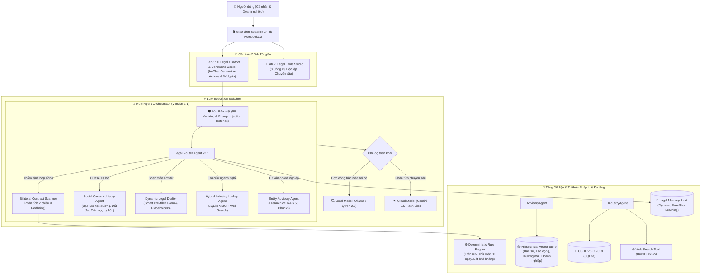

# ⚖️ LegalTech Platform
### Hệ thống Luật sư AI Trực tuyến, Tiến trình Tố tụng, Két Bằng chứng & Bộ Chuyển đổi Văn phong Bình dân • Phiên bản 2.5 (The Plain-Language Dual-Persona Platform)

[-brightgreen.svg)](#quản-lý-phiên-bản--lộ-trình-versioning--roadmap)
[](https://github.com/langchain-ai/langgraph)
[](https://github.com/snowflake-vibing/LLM_Nhut/actions)
[](https://telegram.org/)
[](https://opensource.org/licenses/MIT)
[](https://www.python.org/)
[-FF4B4B.svg)](https://streamlit.io/)

---

## 📜 NGUYÊN TẮC HOẠT ĐỘNG DỰ ÁN (PROJECT RULES)
> 🚨 **QUY ĐỊNH BẮT BUỘC:** Mọi tác vụ phát triển của AI hoặc người đóng góp phải tuân thủ nghiêm ngặt tài liệu:  
> 👉 **[`RULES.md`](./RULES.md)** *(Quy chuẩn đọc đầu tiên, quy tắc đặt tên version preview/requirements và an toàn bảo mật).*

---

## 🚀 QUẢN LÝ PHIÊN BẢN & LỘ TRÌNH (VERSIONING & ROADMAP)

* **Yêu cầu Kỹ thuật Phiên bản 1.0 (Requirements Version 1.0):**
  * Đặc tả 7 tiêu chí chấm điểm ban đầu của giảng viên: [`requirements/requirements_version_1.md`](./requirements/requirements_version_1.md).
* **Đánh giá Phiên bản 1.0 (Preview Version 1):**
  * Tổng hợp nhận xét người dùng & phản biện kỹ thuật sơ khởi: [`requirements/preview_version_1.md`](./requirements/preview_version_1.md).
* **Yêu cầu Kỹ thuật Phiên bản 1.1 (Requirements Version 1.1) - [ĐÃ HOÀN THÀNH]:**
  * 4 nâng cấp thực chiến: Link kiểm chứng Cổng TT Chính phủ, Bộ tạo hồ sơ doanh nghiệp (.docx), Tra cứu Hybrid (CSDL + Web Search), Trực quan hóa PII: [`requirements/requirements_version_1.1.md`](./requirements/requirements_version_1.1.md).
* **Đánh giá Phiên bản 1.1 (Preview Version 1.1):**
  * Đánh giá v1.1, phân tích yêu cầu Tool Thẩm định Lỗ hổng Hợp đồng, In-Chat Generative UI, mở rộng phạm vi toàn bộ văn bản cho cá nhân/doanh nghiệp: [`requirements/preview_version_1.1.md`](./requirements/preview_version_1.1.md).
* **Yêu cầu Kỹ thuật Phiên bản 2.0 (Requirements Version 2.0 - Major Release) - [ĐÃ HOÀN THÀNH 100%]:**
  * Đại tu toàn diện kiến trúc: Quét cạm bẫy hợp đồng, chấm điểm rủi ro pháp lý (0-100), In-Chat Interactive Canvas, Hierarchical RAG Đa luật: [`requirements/requirements_version_2.0.md`](./requirements/requirements_version_2.0.md).
* **Đánh giá Phiên bản 2.0 (Preview Version 2.0):**
  * Đánh giá v2.0, phân tích yêu cầu "Luật sư Online phân tích 2 chiều đối kháng", giải quyết 4 case xã hội, soạn thảo văn bản on-demand và tái cấu trúc thành 2 Tab NotebookLM: [`requirements/preview_version_2.0.md`](./requirements/preview_version_2.0.md).
* **Yêu cầu Kỹ thuật Phiên bản 2.1 (Requirements Version 2.1) - [ĐÃ HOÀN THÀNH 100%]:**
  * The Legal AI Lawyer & Studio Platform: Phân tích hợp đồng 2 chiều đối kháng, 4 case đời sống xã hội, Smart Pre-filled Form with Placeholder Fallback và giao diện 2 Tab NotebookLM: [`requirements/requirements_version_2.1.md`](./requirements/requirements_version_2.1.md).
  * Hướng dẫn chạy và kịch bản test chi tiết: [`tutorial/run_guide_version_2.1.md`](./tutorial/run_guide_version_2.1.md).
* **Đánh giá Phiên bản 2.1 (Preview Version 2.1):**
  * Đánh giá v2.1, phân tích yêu cầu tích hợp chính thức thư viện mã nguồn mở LangGraph (`langchain-ai/langgraph`), trực quan hóa sơ đồ mạng lưới tác nhân và cơ chế tự hành định kỳ (Hourly Watchdog): [`requirements/preview_version_2.1.md`](./requirements/preview_version_2.1.md).
* **Yêu cầu Kỹ thuật Phiên bản 2.2 (Requirements Version 2.2) - [ĐÃ HOÀN THÀNH 100%]:**
  * Tích hợp chính thức LangGraph Stateful Architecture (`StateGraph`, `START`, `END`, Conditional Routing Edges), hiển thị sơ đồ Mermaid thời gian thực và Bộ kiểm thử tự hành định kỳ mỗi 1 giờ: [`requirements/requirements_version_2.2.md`](./requirements/requirements_version_2.2.md).
  * Hướng dẫn chạy và kịch bản test chi tiết: [`tutorial/run_guide_version_2.2.md`](./tutorial/run_guide_version_2.2.md).
* **Đánh giá Phiên bản 2.2 (Preview Version 2.2):**
  * Đánh giá v2.2, giải quyết bài toán chạy ngầm 24/7 khi máy tính tắt nguồn qua GitHub Actions và kênh báo cáo tức thời qua Telegram Bot: [`requirements/preview_version_2.2.md`](./requirements/preview_version_2.2.md).
* **Yêu cầu Kỹ thuật Phiên bản 2.3 (Requirements Version 2.3) - [ĐÃ HOÀN THÀNH 100%]:**
  * The Cloud Autonomous Watchdog & 24/7 Telegram Alert Platform: GitHub Actions Cron mỗi 1 giờ, Telegram Bot Notifier tự động gửi báo cáo sức khỏe hệ thống về điện thoại: [`requirements/requirements_version_2.3.md`](./requirements/requirements_version_2.3.md).
  * Hướng dẫn thiết lập Telegram Bot & GitHub Secrets: [`tutorial/run_guide_version_2.3.md`](./tutorial/run_guide_version_2.3.md).
* **Đánh giá Phiên bản 2.3 (Preview Version 2.3):**
  * Đánh giá v2.3, bước chuyển mình sang chế độ phát triển tự hành liên tục (Continuous Autonomous Development Loop) và báo cáo thay đổi qua Telegram: [`requirements/preview_version_2.3.md`](./requirements/preview_version_2.3.md).
* **Yêu cầu Kỹ thuật Phiên bản 2.4 (Requirements Version 2.4) - [ĐÃ HOÀN THÀNH 100%]:**
  * The Interactive Legal Roadmap & Smart Evidence Vault: Bản đồ tiến trình tố tụng trực quan (Visual Stepper), Két bằng chứng & Thước đo giá trị chứng cứ (Evidentiary Weight Meter 0-100%): [`requirements/requirements_version_2.4.md`](./requirements/requirements_version_2.4.md).
  * Hướng dẫn kiểm thử chi tiết: [`tutorial/run_guide_version_2.4.md`](./tutorial/run_guide_version_2.4.md).
* **Đánh giá Phiên bản 2.4 (Preview Version 2.4):**
  * Đánh giá v2.4, phân tích rào cản thuật ngữ tố tụng và giải pháp bộ chuyển đổi văn phong song ngữ (Plain-Language Dual-Persona Switcher): [`requirements/preview_version_2.4.md`](./requirements/preview_version_2.4.md).
* **Yêu cầu Kỹ thuật Phiên bản 2.5 (Requirements Version 2.5) - [ĐÃ HOÀN THÀNH 100%]:**
  * The Plain-Language Dual-Persona Platform: Chuyển đổi văn phong tư pháp sang ngôn ngữ bình dân gần gũi như bạn bè, thấu tình đạt lý với 1-click in-chat: [`requirements/requirements_version_2.5.md`](./requirements/requirements_version_2.5.md).
  * Hướng dẫn kiểm thử chi tiết: [`tutorial/run_guide_version_2.5.md`](./tutorial/run_guide_version_2.5.md).

---

## 🌟 ĐỘT PHÁ CÔNG NGHỆ TRONG PHIÊN BẢN 2.5 (PLAIN-LANGUAGE DUAL-PERSONA)

1. ☕ **Bộ Chuyển đổi Văn phong Song ngữ (Plain-Language Dual-Persona Switcher):**
   - 1-click chuyển đổi tức thì bên dưới mỗi câu trả lời trong Chatbot:
     - `🏛️ Văn phong Tòa án / Tư pháp`: Chuẩn mực tố tụng viện dẫn đầy đủ điều luật để nộp cơ quan chức năng.
     - `☕ Diễn giải Bình dân / Thấu tình Đạt lý`: Diễn giải mộc mạc, ví von đời thường, chia làm 3 phần (Bản chất, 3 bước nên làm, Cạm bẫy cần tránh).

2. 🗺️ **Bản đồ Tiến trình Tố tụng Trực quan (Interactive Legal Stepper):**
   - Trực quan hóa quy trình xử lý từng bước cho 4 bài toán đời sống nhạy cảm: Đòi nợ khi con nợ bỏ trốn, Tranh chấp ranh giới Sổ đỏ, Bạo lực học đường, Ly hôn & Quyền nuôi con.

3. 🗄️ **Két Bằng Chứng Thông Minh & Thước đo Trọng lượng Chứng cứ (Evidentiary Weight Meter):**
   - Đánh giá hồ sơ chứng cứ theo Chương VII Bộ luật Tố tụng Dân sự 2015, thang đo từ 0 đến 100 điểm kèm cảnh báo lập Vi bằng Thừa phát lại.

4. 📱 **Tự hành Liên tục & Báo cáo Tức thời về Điện thoại qua Telegram:**
   - Hoạt động 24/7, tự động kiểm tra hệ thống và gửi bản tin nâng cấp chi tiết về Telegram sau mỗi chu kỳ.

---

## 🌟 ĐỘT PHÁ CÔNG NGHỆ TRONG PHIÊN BẢN 2.4 (ROADMAP & EVIDENCE VAULT)

1. 🗺️ **Bản đồ Tiến trình Tố tụng Trực quan (Interactive Legal Stepper):**
   - Trực quan hóa quy trình xử lý từng bước cho 4 bài toán đời sống nhạy cảm: Đòi nợ khi con nợ bỏ trốn, Tranh chấp ranh giới Sổ đỏ, Bạo lực học đường, Ly hôn & Quyền nuôi con.
   - Hiển thị rõ: **Cơ quan có thẩm quyền tiếp nhận**, **Mốc thời hạn luật định (Deadline Alert)**, và **Hành động cụ thể** của từng bước.

2. 🗄️ **Két Bằng Chứng Thông Minh & Thước đo Trọng lượng Chứng cứ (Evidentiary Weight Meter):**
   - Đánh giá hồ sơ chứng cứ theo Chương VII Bộ luật Tố tụng Dân sự 2015.
   - Thang đo trực quan từ 0 đến 100 điểm: Phân loại chứng cứ (Văn bản công chứng, Vi bằng thừa phát lại, Sao kê ngân hàng, Giấy viết tay, Tin nhắn Zalo...).
   - Đưa ra cảnh báo pháp lý khẩn cấp (ví dụ: *chỉ có ảnh chụp màn hình Zalo thì nguy cơ bị bác đơn, cần đi lập Vi bằng ngay*).

3. ☁️ **Hệ thống Giám sát & Báo cáo Tự hành 24/7 về Telegram:**
   - Hoạt động liên tục, tự động gửi báo cáo tóm tắt tiến độ và các thay đổi trực tiếp về tài khoản Telegram của bạn.

4. 🌐 **Lõi Điều phối Đa tác nhân LangGraph (`langchain-ai/langgraph`):**
   - Mô hình `StateGraph` với các Node chuyên môn độc lập và sơ đồ mạng lưới trực quan.

---

## 🌟 ĐỘT PHÁ CÔNG NGHỆ TRONG PHIÊN BẢN 2.3 (THE CLOUD WATCHDOG & TELEGRAM)

1. ☁️ **Tự hành 24/7 trên Cloud qua GitHub Actions (`deploy/hourly_watchdog.yml`):**
   - Kích hoạt định kỳ mỗi 1 giờ trên hạ tầng máy chủ Cloud độc lập của GitHub/Microsoft.
   - **Hoạt động 24/7 ngay cả khi máy tính cá nhân của người dùng đã tắt nguồn hoàn toàn**.
   - Tự động kéo code, thiết lập môi trường Python 3.11, chạy kiểm thử hồi quy Model Cloud, Vector DB và luồng LangGraph.

2. 📱 **Kênh Báo cáo Tức thời về Điện thoại qua Telegram Bot (`src/security/telegram_notifier.py`):**
   - Tự động gửi tin nhắn báo cáo định dạng chuẩn mực về điện thoại sau mỗi chu kỳ kiểm tra:
     - ⏱️ Timestamp thực thi.
     - ☁️ Trạng thái Cloud Gemini API.
     - 💻 Trạng thái Local Ollama Model.
     - 📚 Số lượng Chunks Vector DB đã được lập chỉ mục an toàn.
     - 🌐 Trạng thái toàn bộ luồng LangGraph Stateful Workflow.
     - 📦 Trạng thái nhánh Git trên repository.

3. 🌐 **Lõi Điều phối Đa tác nhân LangGraph (`langchain-ai/langgraph`):**
   - Sử dụng chuẩn mực `StateGraph`, `START`, `END` và rẽ nhánh có điều kiện (*Conditional Routing Edges*).
   - Xuất sơ đồ mạng lưới tác nhân dạng Mermaid trực tiếp trên Web.

4. ⚖️ **Phân tích Hợp đồng 2 Chiều Đối kháng (Bilateral Exploitation Analysis):**
   - Bóc tách cạm bẫy từ góc nhìn Bên ra luật (bên mạnh) vs Bên theo luật (bên yếu), đề xuất điều khoản dung hòa (Neutral Balanced Clause) và xuất file Word (.docx).

5. 🏛️ **4 Tình huống Pháp lý Đời sống Xã hội Thực tiễn:**
   - Bạo lực học đường (Điều 599 BLDS 2015), Tranh chấp đất đai (Điều 202 Luật Đất đai), Đòi nợ khi con nợ bỏ trốn (Điều 39, 40 BLTTDS, Điều 175 BLHS), Ly hôn & Quyền nuôi con dưới 36 tháng (Điều 81 Luật HNGĐ 2014).

6. 📝 **Biểu mẫu Thông minh Điền sẵn Căn cứ Pháp luật (Placeholder Fallback Engine):**
   - AI điền sẵn 100% căn cứ pháp luật và nội dung tranh tụng. Thông tin cá nhân để trống sẽ tự động chèn dòng kẻ `........................` để in ra ký tên hoặc nộp ngay.

7. 💻 **Trải nghiệm 2 Tab Tối giản Phong cách NotebookLM:**
   - **Tab 1: 💬 AI Legal Chatbot & Command Center:** In-Chat Everything.
   - **Tab 2: 🧰 Legal Tools Studio:** Trưng bày 9 công cụ chuyên sâu bao gồm LangGraph Visualizer.

4. 🏛️ **4 Tình huống Pháp lý Đời sống Xã hội Thực tiễn:**
   - Bạo lực học đường (Điều 599 BLDS 2015), Tranh chấp đất đai (Điều 202 Luật Đất đai), Đòi nợ khi con nợ bỏ trốn (Điều 39, 40 BLTTDS, Điều 175 BLHS), Ly hôn & Quyền nuôi con dưới 36 tháng (Điều 81 Luật HNGĐ 2014).

5. 📝 **Biểu mẫu Thông minh Điền sẵn Căn cứ Pháp luật (Placeholder Fallback Engine):**
   - AI điền sẵn 100% căn cứ pháp luật và nội dung tranh tụng. Thông tin cá nhân để trống sẽ tự động chèn dòng kẻ `........................` để in ra ký tên hoặc nộp ngay.

6. 💻 **Trải nghiệm 2 Tab Tối giản Phong cách NotebookLM:**
   - **Tab 1: 💬 AI Legal Chatbot & Command Center:** In-Chat Everything.
   - **Tab 2: 🧰 Legal Tools Studio:** Trưng bày 9 công cụ chuyên sâu bao gồm LangGraph Visualizer.

---

## 🏛️ 3. Kiến trúc Hệ thống Version 2.1 (System Architecture)



---

## 📂 4. Cấu trúc Thư mục Dự án

```
LLM_Nhut/
├── app/
│   └── main.py                  # Giao diện Streamlit 2 Tab chuẩn NotebookLM (AI Chatbot & Tools Studio)
├── data/
│   ├── chromadb/                # CSDL Vector (Index lưu trữ 53 chunks đa luật)
│   ├── database/                # CSDL SQLite (schema.sql & sme_legal.db) + legal_memory_bank.json
│   ├── evaluation/              # Dataset benchmark (benchmark_dataset.json)
│   └── raw_documents/           # 8 bộ luật nguồn (Dân sự, Lao động, Thương mại, Doanh nghiệp, Đất đai, Hôn nhân gia đình...)
├── llm_provider/                # Module Cloud & Local LLM Provider
│   ├── cloud_provider.py        # Tích hợp Google Gemini API
│   ├── local_provider.py        # Tích hợp Ollama Local API
│   └── model_factory.py         # Factory Switcher & Auto-fallback
├── reports/                     # Báo cáo và kết quả đo lường
│   ├── evaluation_results.csv   # Kết quả benchmark Ragas chi tiết
│   ├── model_comparison_report.md # Báo cáo so sánh Cloud vs Local
│   ├── presentation_slides.md   # Slide thuyết trình báo cáo đồ án
│   └── PROJECT_REPORT.md        # Báo cáo đồ án hoàn chỉnh 8 chương
├── requirements/                # Quản lý yêu cầu & Phiên bản (Quy chuẩn RULES.md)
│   ├── preview_version_1.md     # Đánh giá Version 1.0 & Phản biện kỹ thuật
│   ├── requirements_version_1.md # 7 tiêu chí chấm điểm Version 1.0
│   ├── preview_version_1.1.md   # Đánh giá Version 1.1 & Phản biện Continual Learning
│   ├── requirements_version_1.1.md # Yêu cầu kỹ thuật Version 1.1
│   ├── preview_version_2.0.md   # Đánh giá Version 2.0 (Luật sư 2 chiều & 4 case xã hội)
│   ├── requirements_version_2.0.md # Yêu cầu kỹ thuật Version 2.0 (Major Release)
│   └── requirements_version_2.1.md # Yêu cầu kỹ thuật Version 2.1 (The AI Lawyer & Studio)
├── src/
│   ├── agents/                  # Multi-Agent Workflow (Router, Advisory, Lookup, Reviewer, MemoryStore, Graph)
│   ├── database/                # Quản lý truy vấn SQLite (db_manager.py)
│   ├── dossier/                 # Tạo lập hồ sơ doanh nghiệp & Soạn thảo văn bản thông minh (dynamic_drafter.py)
│   ├── evaluation/              # Framework đánh giá Ragas (ragas_evaluator.py)
│   ├── rag/                     # Hierarchical RAG (embeddings, ingestion, retriever, vector_store)
│   ├── security/                # Guardrails (pii_masker, prompt_injection, moderator)
│   └── tools/                   # Web search tool, Contract scanner, Social cases knowledge
└── tutorial/                    # Hướng dẫn kiểm thử thực tế (run_guide_version_2.1.md)
├── .env.example                 # Template cấu hình biến môi trường
├── .gitignore                   # Loại trừ cache, venv, .env
├── LICENSE                      # Giấy phép MIT
├── README.md                    # Tài liệu tổng quan dự án
└── RULES.md                     # Quy định hoạt động bắt buộc cho AI
```

---

## 🚀 5. Hướng dẫn Khởi chạy Nhanh

Xem hướng dẫn chi tiết từng bước & bộ test cases tại:  
👉 **[`tutorial/run_guide_version_2.0.md`](./tutorial/run_guide_version_2.0.md)** *(Hướng dẫn & Test Cases thực chiến cho Version 2.0)*  
👉 **[`tutorial/run_guide.md`](./tutorial/run_guide.md)** *(Hướng dẫn nền tảng các phiên bản trước)*

```bash
# 1. Kích hoạt môi trường ảo
.\venv\Scripts\Activate.ps1

# 2. Khởi tạo CSDL SQLite (nếu chưa chạy)
python src/database/init_db.py

# 3. Khởi chạy giao diện web Streamlit (Version 2.0)
streamlit run app/main.py
```
Mở trình duyệt tại: `http://localhost:8501`.