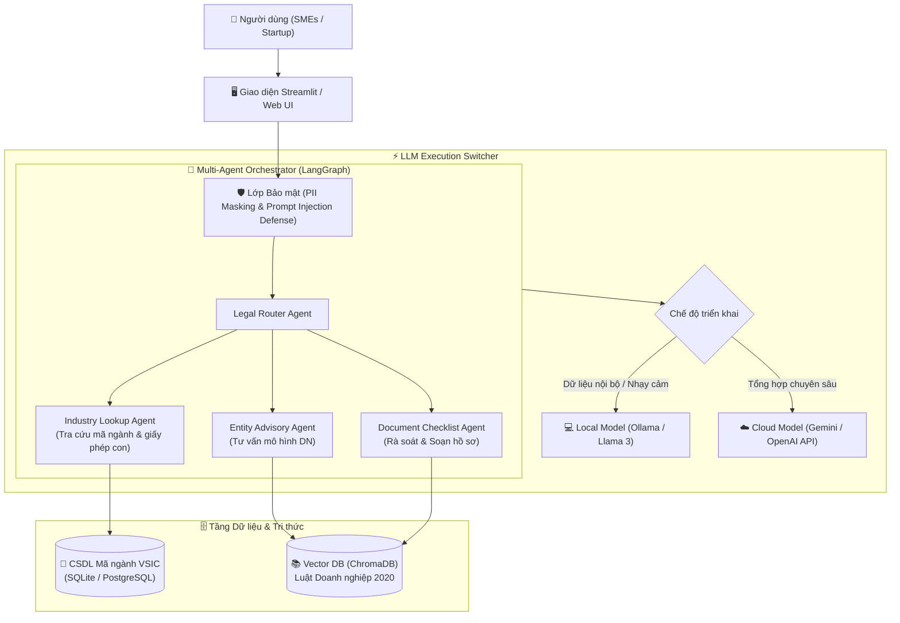

# ⚖️ LegalTech SME Assistant
### Trợ lý AI Hỗ trợ Tư vấn & Tự động Hóa Thủ tục Pháp lý cho Doanh nghiệp Vừa và Nhỏ (SMEs & Hộ Kinh Doanh)

[](https://opensource.org/licenses/MIT)
[](https://www.python.org/)
[](https://fastapi.tiangolo.com/)
[](https://streamlit.io/)
[](https://ollama.ai/)
[](https://www.langchain.com/)

---

## 📖 1. Giới thiệu Đề tài & Bài toán Doanh nghiệp (Business Case)
Khi thành lập hoặc mở rộng kinh doanh tại Việt Nam, các **Doanh nghiệp vừa và nhỏ (SMEs), Startup và Hộ kinh doanh cá thể** đối mặt với rào cản pháp lý rất lớn:
* **Nỗi đau (Pain points):** Hệ thống luật pháp (Luật Doanh nghiệp, Luật Đầu tư, Luật Thuế), nghị định, thông tư phức tạp; thủ tục xin giấy phép con (ATVSTP, PCCC, giấy phép môi trường...) phân tán; chi phí thuê văn phòng luật sư tư vấn vượt quá ngân sách ban đầu.
* **Giải pháp:** **LegalTech SME Assistant** là hệ thống AI Agent hỗ trợ:
  * Phân tích ý tưởng kinh doanh $\rightarrow$ Định hướng mô hình doanh nghiệp tối ưu (TNHH, Cổ phần, Hộ cá thể).
  * Tự động tra cứu mã ngành kinh tế (VSIC) từ Cơ sở dữ liệu quốc gia.
  * Truy xuất điều kiện cấp phép con chính xác từ các văn bản pháp luật chính thống (RAG).
  * Hướng dẫn soạn thảo checklist hồ sơ pháp lý từng bước.

---

## 🎯 2. Đáp ứng 7 Tiêu chí Đánh giá Dự án AI Engineer

| STT | Tiêu chí | Trọng số | Triển khai trong Dự án |
| :---: | :--- | :---: | :--- |
| **1** | **Ứng dụng LLM Doanh nghiệp** | **1.0 đ** | Giải quyết bài toán tư vấn pháp lý và thành lập doanh nghiệp thực tế, tiết kiệm thời gian và chi phí cho SMEs. |
| **2** | **Kỹ năng Prompting** | **2.0 đ** | Áp dụng Few-shot Prompting (mẫu trích xuất pháp lý), Chain-of-Thought (tư duy logic đối chiếu điều luật) và Structured Output (JSON Schema hồ sơ thành lập). |
| **3** | **Cloud Server & Local Model** | **2.5 đ** | Hỗ trợ chuyển đổi linh hoạt (*Model Switcher*):<br>• **Local Model:** Ollama (Llama 3.1 / Qwen 2.5) xử lý thông tin nội bộ nhạy cảm.<br>• **Cloud Model:** Google Gemini 1.5 Pro / OpenAI GPT-4o cho các tác vụ tổng hợp chuyên sâu. |
| **4** | **Vector DB & Đọc CSDL** | **1.5 đ** | • **RAG (Vector DB - ChromaDB):** Đọc & phân tích PDF Bộ Luật Doanh nghiệp 2020, Nghị định đăng ký DN.<br>• **CSDL (SQLite / PostgreSQL):** Bảng Hệ thống ngành kinh tế Việt Nam (VSIC), Bảng quản lý tiến độ hồ sơ. |
| **5** | **AI Agents & Đa Tác Nhân** | **1.5 đ** | Kiến trúc Multi-Agent xây dựng trên **LangGraph**:<br>• *Legal Router Agent:* Phân loại nhu cầu & ý định người dùng.<br>• *Entity Advisory Agent:* Tư vấn mô hình tổ chức doanh nghiệp.<br>• *Industry Lookup Agent:* Tra cứu mã ngành & điều kiện cấp phép.<br>• *Document Reviewer Agent:* Rà soát tính hợp lệ của checklist hồ sơ. |
| **6** | **Đánh giá mô hình LLM** | **1.0 đ** | Sử dụng framework **Ragas** đo lường: Faithfulness (chống bịa đặt điều luật), Answer Relevance, Context Precision. Báo cáo so sánh Local vs Cloud. |
| **7** | **Bảo mật LLM** | **0.5 đ** | • **PII Data Masking:** Tự động che dấu CCCD/CMND, số điện thoại, địa chỉ nhà chủ doanh nghiệp trước khi gọi LLM ngoài.<br>• **Prompt Injection Guard:** Chặn câu lệnh cố tình bẻ khóa để hỏi cách lách luật, trốn thuế. |

---

## 🏛️ 3. Kiến trúc Hệ thống (System Architecture)



---

## 📂 4. Cấu trúc Thư mục Dự án Dự kiến

```
LLM_Nhut/
├── data/
│   ├── raw_documents/       # File PDF Luật Doanh nghiệp, Nghị định, Thông tư
│   ├── database/            # File CSDL SQLite (bảng mã ngành VSIC, bảng tiến độ)
│   └── chromadb/            # Vector Database lưu embeddings văn bản luật
├── src/
│   ├── agents/              # Multi-Agent Workflow (Router, Advisory, Lookup, Reviewer)
│   ├── rag/                 # Pipeline Ingestion, Chunking, Embedding & Retrieval
│   ├── database/            # Database connection & Tool query SQL
│   ├── security/            # PII Masking, Prompt Injection Defense (Guardrails)
│   ├── evaluation/          # Benchmark dataset & Ragas evaluation scripts
│   └── llm_providers/       # Cấu hình Cloud (Gemini) & Local (Ollama)
├── app/                     # Giao diện người dùng (Streamlit Frontend)
├── requirements/
│   └── project_requirements.md # Chi tiết yêu cầu & tiêu chí chấm điểm
├── tests/                   # Unit test cho agents và tools
├── .env.example             # Template cấu hình API Keys & biến môi trường
├── requirements.txt         # Thư viện phụ thuộc Python
└── README.md                # Tài liệu dự án
```

---

## 🚀 5. Hướng dẫn Khởi chạy Nhanh (Quickstart)

### 1. Chuẩn bị Môi trường
```bash
# Clone repository
git clone https://github.com/snowflake-vibing/LLM_Nhut.git
cd LLM_Nhut

# Tạo môi trường ảo
python -m venv venv
venv\Scripts\activate   # Trên Windows

# Cài đặt thư viện
pip install -r requirements.txt
```

### 2. Cấu hình biến môi trường
Tạo file `.env` từ `.env.example`:
```env
GOOGLE_API_KEY=your_gemini_api_key_here
OLLAMA_BASE_URL=http://localhost:11434
MODEL_MODE=cloud  # hoặc local
```

### 3. Khởi chạy Ứng dụng
```bash
streamlit run app/main.py
```