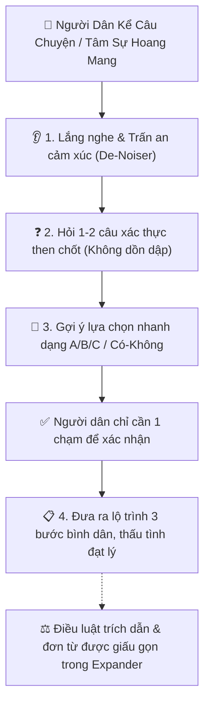
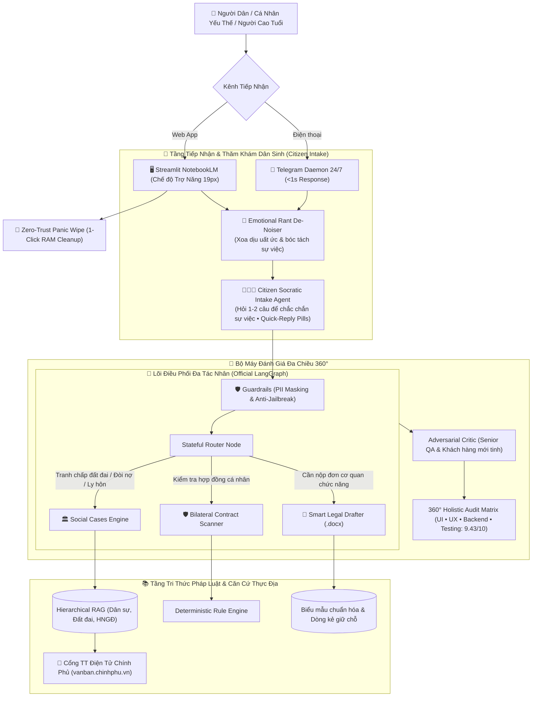

# ⚖️ LegalTech Platform
### Nền Tảng Trợ Lý Pháp Lý Dân Sinh, Socratic Intake & Trạm Làm Việc Tranh Tụng Toàn Diện • Phiên bản 3.0 (The Citizen-Centric Legal Workstation)

[-brightgreen.svg)](#quản-lý-phiên-bản--lộ-trình-versioning--roadmap)
[](#tầm-nhìn-chiến-lược-project-vision)
[](#triết-lý-tương-tác-vàng-core-philosophy)
[](#)
[](#)
[](#)
[](#)
[](https://deepmind.google/)
[](https://github.com/langchain-ai/langgraph)
[](https://telegram.org/)
[](https://opensource.org/licenses/MIT)
[](https://www.python.org/)
[-FF4B4B.svg)](https://streamlit.io/)
[](#)
[](#)
[](#tầm-nhìn-chiến-lược-project-vision)
[](#triết-lý-tương-tác-vàng-core-philosophy)
[](#)
[](#)
[](#)
[](https://deepmind.google/)
[](https://github.com/langchain-ai/langgraph)
[](https://telegram.org/)
[](https://opensource.org/licenses/MIT)
[](https://www.python.org/)
[-FF4B4B.svg)](https://streamlit.io/)

---

## 🎯 TẦM NHÌN CHIẾN LƯỢC (PROJECT VISION)

> **"Dân chủ hóa và nhân văn hóa công nghệ pháp lý cho mọi người dân Việt Nam."**  
> 
> Một sản phẩm LegalTech thực sự có giá trị không phải là một "tech-demo" phô diễn công nghệ dễ dãi, mà phải là sản phẩm **phục vụ được những người yếu thế nhất trong xã hội**:
> - **Người già & người ít thạo công nghệ:** Cần giao diện chữ lớn, tương phản cao, thao tác 1 chạm, không đòi hỏi kỹ năng số phức tạp.
> - **Người dân bình thường khi gặp biến cố:** Khi bị quỵt nợ, tranh chấp đất đai với hàng xóm, trục trặc hôn nhân hay bị lừa đảo qua mạng thường rất hoang mang, uất ức và "nói không đâu vào đâu". Họ không thể hiểu và sẽ sợ hãi nếu AI lập tức "xả" một tràng dài điều luật khô khan.
> - **Triết lý Thăm khám Từng bước (Socratic Intake):** AI đóng vai một **Vị Luật sư Dân gian Đồng hành** — biết lắng nghe, xoa dịu cảm xúc, hỏi từng bước (tối đa 1-2 câu ngắn) để nắm chắc tình tiết và bằng chứng trước khi kết luận, kèm các nút chọn nhanh (Quick-Reply Pills) để người dân chỉ cần bấm chọn.
> - **Phạm vi Doanh nghiệp & Công ty:** Tạm thời được đưa vào chế độ chờ (Standby) tại Studio để dự án dồn 100% tâm huyết giải quyết bài toán dân sinh đời sống trước mắt.

---

## 💡 TRIẾT LÝ TƯƠNG TÁC VÀNG (CORE INTERACTION PRINCIPLES)



1. 🚫 **TUYỆT ĐỐI KHÔNG TRẢ LỜI DỒN DẬP:** Không trút tràng dài điều luật Bộ luật Dân sự hay Tố tụng vào tin nhắn chính khiến người dân bị ngợp hoặc bất an.
2. ❓ **HỎI ĐỂ CHẮC CHẮN (Socratic Legal Intake):** Luôn hỏi 1-2 câu trọng tâm để làm rõ:
   - *Thời điểm xảy ra sự việc?*
   - *Bằng chứng hiện có (Giấy viết tay, sao kê ngân hàng, tin nhắn Zalo, hay chỉ nói miệng)?*
   - *Mục tiêu ưu tiên (Hòa giải lấy lại tiền, báo Công an, hay khởi kiện ra Tòa)?*
3. 🔘 **LỰA CHỌN TRẢ LỜI NHANH (Quick-Reply Pills):** Tự động sinh ra các nút bấm gợi ý để người già hoặc người dùng điện thoại chỉ cần bấm chọn thay vì phải gõ bàn phím dài dòng.
4. 👵 **TRỢ NĂNG NGƯỜI CAO TUỔI (Senior Accessible Mode):** Nút bật/tắt tức thì trên thanh Sidebar phóng to font chữ lên **19px**, tăng line-height **1.85**, chống mỏi mắt.
5. 🚨 **BẢO MẬT ZERO-TRUST & NÚT XÓA DẤU VẾT (Panic Wipe):** 1-click giải phóng sạch RAM, bảo vệ an toàn tính mạng cho nạn nhân bạo lực gia đình hoặc người bị theo dõi.
6. 📱 **ĐA KÊNH THƯỜNG TRỰC (<1 GIÂY):** Hoạt động đồng bộ trên Web Streamlit và Bot Telegram Daemon 24/7 (`@SnowflakeVibingBot`).

---

## 📜 NGUYÊN TẮC HOẠT ĐỘNG DỰ ÁN (PROJECT RULES)
> 🚨 **QUY ĐỊNH BẮT BUỘC:** Mọi tác vụ phát triển của AI hoặc người đóng góp phải tuân thủ nghiêm ngặt tài liệu:  
> 👉 **[`RULES.md`](./RULES.md)** *(Quy chuẩn đọc đầu tiên, quy tắc đặt tên version preview/requirements và an toàn bảo mật).*

---

## 🚀 QUẢN LÝ PHIÊN BẢN & LỘ TRÌNH (VERSIONING & ROADMAP)

* **Yêu cầu Kỹ thuật Phiên bản 1.0 (Requirements Version 1.0):**
  * Đặc tả 7 tiêu chí chấm điểm ban đầu của giảng viên: [`requirements/requirements_version_1.md`](./requirements/requirements_version_1.md).
* **Đánh giá Phiên bản 1.0 (Preview Version 1):**
  * Tổng hợp nhận xét người dùng & phản biện kỹ thuật sơ khởi: [`requirements/preview_version_1.md`](./requirements/preview_version_1.md).
* **Yêu cầu Kỹ thuật Phiên bản 1.1 (Requirements Version 1.1) - [ĐÃ HOÀN THÀNH]:**
  * 4 nâng cấp thực chiến: Link kiểm chứng Cổng TT Chính phủ, Bộ tạo hồ sơ doanh nghiệp (.docx), Tra cứu Hybrid (CSDL + Web Search), Trực quan hóa PII: [`requirements/requirements_version_1.1.md`](./requirements/requirements_version_1.1.md).
* **Đánh giá Phiên bản 1.1 (Preview Version 1.1):**
  * Đánh giá v1.1, phân tích yêu cầu Tool Thẩm định Lỗ hổng Hợp đồng, In-Chat Generative UI, mở rộng phạm vi toàn bộ văn bản cho cá nhân/doanh nghiệp: [`requirements/preview_version_1.1.md`](./requirements/preview_version_1.1.md).
* **Yêu cầu Kỹ thuật Phiên bản 2.0 (Requirements Version 2.0 - Major Release) - [ĐÃ HOÀN THÀNH 100%]:**
  * Đại tu toàn diện kiến trúc: Quét cạm bẫy hợp đồng, chấm điểm rủi ro pháp lý (0-100), In-Chat Interactive Canvas, Hierarchical RAG Đa luật: [`requirements/requirements_version_2.0.md`](./requirements/requirements_version_2.0.md).
* **Đánh giá Phiên bản 2.0 (Preview Version 2.0):**
  * Đánh giá v2.0, phân tích yêu cầu "Luật sư Online phân tích 2 chiều đối kháng", giải quyết 4 case xã hội, soạn thảo văn bản on-demand và tái cấu trúc thành 2 Tab NotebookLM: [`requirements/preview_version_2.0.md`](./requirements/preview_version_2.0.md).
* **Yêu cầu Kỹ thuật Phiên bản 2.1 (Requirements Version 2.1) - [ĐÃ HOÀN THÀNH 100%]:**
  * The Legal AI Lawyer & Studio Platform: Phân tích hợp đồng 2 chiều đối kháng, 4 case đời sống xã hội, Smart Pre-filled Form with Placeholder Fallback và giao diện 2 Tab NotebookLM: [`requirements/requirements_version_2.1.md`](./requirements/requirements_version_2.1.md).
  * Hướng dẫn chạy và kịch bản test chi tiết: [`tutorial/run_guide_version_2.1.md`](./tutorial/run_guide_version_2.1.md).
* **Đánh giá Phiên bản 2.1 (Preview Version 2.1):**
  * Đánh giá v2.1, phân tích yêu cầu tích hợp chính thức thư viện mã nguồn mở LangGraph (`langchain-ai/langgraph`), trực quan hóa sơ đồ mạng lưới tác nhân và cơ chế tự hành định kỳ (Hourly Watchdog): [`requirements/preview_version_2.1.md`](./requirements/preview_version_2.1.md).
* **Yêu cầu Kỹ thuật Phiên bản 2.2 (Requirements Version 2.2) - [ĐÃ HOÀN THÀNH 100%]:**
  * Tích hợp chính thức LangGraph Stateful Architecture (`StateGraph`, `START`, `END`, Conditional Routing Edges), hiển thị sơ đồ Mermaid thời gian thực và Bộ kiểm thử tự hành định kỳ mỗi 1 giờ: [`requirements/requirements_version_2.2.md`](./requirements/requirements_version_2.2.md).
  * Hướng dẫn chạy và kịch bản test chi tiết: [`tutorial/run_guide_version_2.2.md`](./tutorial/run_guide_version_2.2.md).
* **Đánh giá Phiên bản 2.2 (Preview Version 2.2):**
  * Đánh giá v2.2, giải quyết bài toán chạy ngầm 24/7 khi máy tính tắt nguồn qua GitHub Actions và kênh báo cáo tức thời qua Telegram Bot: [`requirements/preview_version_2.2.md`](./requirements/preview_version_2.2.md).
* **Yêu cầu Kỹ thuật Phiên bản 2.3 (Requirements Version 2.3) - [ĐÃ HOÀN THÀNH 100%]:**
  * The Cloud Autonomous Watchdog & 24/7 Telegram Alert Platform: GitHub Actions Cron mỗi 1 giờ, Telegram Bot Notifier tự động gửi báo cáo sức khỏe hệ thống về điện thoại: [`requirements/requirements_version_2.3.md`](./requirements/requirements_version_2.3.md).
  * Hướng dẫn thiết lập Telegram Bot & GitHub Secrets: [`tutorial/run_guide_version_2.3.md`](./tutorial/run_guide_version_2.3.md).
* **Đánh giá Phiên bản 2.3 (Preview Version 2.3):**
  * Đánh giá v2.3, bước chuyển mình sang chế độ phát triển tự hành liên tục (Continuous Autonomous Development Loop) và báo cáo thay đổi qua Telegram: [`requirements/preview_version_2.3.md`](./requirements/preview_version_2.3.md).
* **Yêu cầu Kỹ thuật Phiên bản 2.4 (Requirements Version 2.4) - [ĐÃ HOÀN THÀNH 100%]:**
  * The Interactive Legal Roadmap & Smart Evidence Vault: Bản đồ tiến trình tố tụng trực quan (Visual Stepper), Két bằng chứng & Thước đo giá trị chứng cứ (Evidentiary Weight Meter 0-100%): [`requirements/requirements_version_2.4.md`](./requirements/requirements_version_2.4.md).
  * Hướng dẫn kiểm thử chi tiết: [`tutorial/run_guide_version_2.4.md`](./tutorial/run_guide_version_2.4.md).
* **Đánh giá Phiên bản 2.4 (Preview Version 2.4):**
  * Đánh giá v2.4, phân tích rào cản thuật ngữ tố tụng và giải pháp bộ chuyển đổi văn phong song ngữ (Plain-Language Dual-Persona Switcher): [`requirements/preview_version_2.4.md`](./requirements/preview_version_2.4.md).
* **Yêu cầu Kỹ thuật Phiên bản 2.5 (Requirements Version 2.5) - [ĐÃ HOÀN THÀNH 100%]:**
  * The Plain-Language Dual-Persona Platform: Chuyển đổi văn phong tư pháp sang ngôn ngữ bình dân gần gũi như bạn bè, thấu tình đạt lý với 1-click in-chat: [`requirements/requirements_version_2.5.md`](./requirements/requirements_version_2.5.md).
  * Hướng dẫn kiểm thử chi tiết: [`tutorial/run_guide_version_2.5.md`](./tutorial/run_guide_version_2.5.md).
* **Đánh giá Phiên bản 2.5 (Preview Version 2.5):**
  * Đánh giá v2.5, giải pháp điều khiển từ xa qua Telegram (/start, /end, /status) kết hợp sức mạnh tự hành Google Antigravity: [`requirements/preview_version_2.5.md`](./requirements/preview_version_2.5.md).
* **Yêu cầu Kỹ thuật Phiên bản 2.6 (Requirements Version 2.6) - [ĐÃ HOÀN THÀNH 100%]:**
  * The Telegram Remote Control & Antigravity Platform: Điều khiển chu kỳ tự hành 100% từ xa trên điện thoại qua lệnh `/start` và `/end`, phối hợp Antigravity Scheduler & Watchdog: [`requirements/requirements_version_2.6.md`](./requirements/requirements_version_2.6.md).
  * Hướng dẫn kiểm thử chi tiết: [`tutorial/run_guide_version_2.6.md`](./tutorial/run_guide_version_2.6.md).
* **Đánh giá Phiên bản 2.6 (Preview Version 2.6):**
  * Đánh giá v2.6, phân tích nguyên nhân Telegram chậm phản hồi và yêu cầu hệ thống Đa Tác Nhân chuyên trách + Phản biện 2 vai (QA Tester & First-Time Customer): [`requirements/preview_version_2.6.md`](./requirements/preview_version_2.6.md).
* **Yêu cầu Kỹ thuật Phiên bản 2.7 (Requirements Version 2.7) - [ĐÃ HOÀN THÀNH 100%]:**
  * The Specialized Multi-Agent Swarm Platform: Phân rã 4 Tác nhân chuyên trách, Adversarial Dual-Persona Tester Agent (Senior QA & Khách hàng mới tinh), và Real-time Telegram Daemon Agent phản hồi tức thì < 1s: [`requirements/requirements_version_2.7.md`](./requirements/requirements_version_2.7.md).
  * Hướng dẫn kiểm thử chi tiết: [`tutorial/run_guide_version_2.7.md`](./tutorial/run_guide_version_2.7.md).
* **Đánh giá Phiên bản 2.7 (Preview Version 2.7):**
  * Phản biện gắt gao của User về thái độ "dễ dãi" của tech-demo, đặt con người yếu thế làm trọng tâm: Người cao tuổi, người không hiểu luật nói hoang mang lộn xộn, tốc độ tải trang và bảo mật dữ liệu tuyệt đối: [`requirements/preview_version_2.7.md`](./requirements/preview_version_2.7.md).
* **Yêu cầu Kỹ thuật Phiên bản 2.8 (Requirements Version 2.8) - [ĐÃ HOÀN THÀNH 100%]:**
  * Human-Centric LegalTech & Zero-Trust Ephemeral Privacy: Chế độ trợ năng Người cao tuổi (Chữ lớn 19px, độ tương phản cao), Bộ lọc tâm sự hoang mang/uất ức (Emotional Rant De-Noiser), Nút Xóa Sạch Dấu Vết Khẩn Cấp (Panic Wipe): [`requirements/requirements_version_2.8.md`](./requirements/requirements_version_2.8.md).
  * Hướng dẫn kiểm thử chi tiết: [`tutorial/run_guide_version_2.8.md`](./tutorial/run_guide_version_2.8.md).
* **Đánh giá Phiên bản 2.8 (Preview Version 2.8):**
  * Đánh giá v2.8 và phân tích yêu cầu bộ máy kiểm định độc lập đa chiều toàn diện 360° (UI, UX, Backend, Testing): [`requirements/preview_version_2.8.md`](./requirements/preview_version_2.8.md).
* **Yêu cầu Kỹ thuật Phiên bản 2.9 (Requirements Version 2.9) - [ĐÃ HOÀN THÀNH 100%]:**
  * The Holistic 360° Multi-Dimensional Audit & Benchmark Suite: Ma trận kiểm định 4 trụ cột x 5 tiêu chí vi mô (= 20 chỉ số), tích hợp công cụ thứ 10 trong Studio và lệnh `/audit` trực tiếp trên Telegram: [`requirements/requirements_version_2.9.md`](./requirements/requirements_version_2.9.md).
  * Hướng dẫn kiểm thử chi tiết: [`tutorial/run_guide_version_2.9.md`](./tutorial/run_guide_version_2.9.md).
* **Đánh giá Phiên bản 2.9 (Preview Version 2.9):**
  * Phân tích chỉ đạo chiến lược của User: Chuyển toàn bộ trọng tâm sang Cá nhân & Người dân; loại bỏ thói quen trả lời dồn dập, chuyển sang đối thoại thăm khám từng bước để nắm chắc sự việc: [`requirements/preview_version_2.9.md`](./requirements/preview_version_2.9.md).
* **Yêu cầu Kỹ thuật Phiên bản 3.0 (Requirements Version 3.0 - Major Release) - [ĐÃ HOÀN THÀNH 100% & TOÀN DIỆN HÓA]:**
  * The Citizen-Centric Conversational Legal Workstation & Multimodal Judicial Suite: Đại tu toàn diện lấy người dân và người cao tuổi làm trọng tâm; thăm khám Socratic từng bước (`CitizenIntakeAgent`), gợi ý kép 1-chạm, trợ lý giọng nói tiếng Việt song phương (TTS & Audio Input), hộp công cụ dân sinh 6 tabs (Tính án phí NQ 326, Xuất đơn Mẫu 23-DS, Thời hiệu BLDS, Thẩm quyền Tòa án, Bàn cờ tố tụng đối kháng 2 chiều & Dự báo tỷ lệ thắng kiện, Đóng gói trọn bộ hồ sơ .docx): [`requirements/requirements_version_3.0.md`](./requirements/requirements_version_3.0.md).
  * Hướng dẫn kiểm thử và trải nghiệm toàn diện: [`tutorial/run_guide_version_3.0.md`](./tutorial/run_guide_version_3.0.md).

---

## 🌟 BỘ NĂNG LỰC ĐỘT PHÁ TOÀN DIỆN TRONG PHIÊN BẢN 3.0 (THE CITIZEN-CENTRIC LEGAL WORKSTATION)

1. 👨‍👩‍👧 **Tác Nhân Thăm Khám Socratic & Gợi Ý Kép 1-Chạm (`src/agents/citizen_intake_agent.py`):**
   - **Tuyệt đối không trả lời dồn dập:** Lọc bỏ cảm xúc hoang mang/uất ức (`EmotionalRantParser`), hỏi từng bước 1-2 câu then chốt để xác minh chứng cứ và mốc thời gian.
   - **Gợi ý kép thông minh:** Hàng 1 là nút bấm trả lời nhanh (A/B/C, Có/Không) để người già không phải gõ bàn phím; Hàng 2 là gợi ý các câu hỏi đào sâu then chốt người dân nên hỏi luật sư.

2. 🎙️ **Trợ Lý Giọng Nói Tiếng Việt Song Phương (Voice-to-Voice AI):**
   - **Cổng Thu Âm Giọng Nói (`st.audio_input`):** Người dân chỉ cần nói trực tiếp câu chuyện của mình, không cần gõ phím.
   - **Phát Thanh Viên Tiếng Việt (Text-to-Speech - TTS - `src/tools/voice_narrator.py`):** Nút `🔊 Đọc to lời giải thích bằng giọng nói` xuất hiện dưới mỗi câu trả lời của AI. Làm sạch thẻ Markdown và cất giọng đọc tiếng Việt truyền cảm, ấm áp, xóa bỏ rào cản căng mắt đọc chữ cho người cao tuổi và người khiếm thị.

3. 🧮 **Hộp Công Cụ Dân Sinh In-Chat 1-Chạm (6 Tabs Hoàn Chỉnh):**
   - 💰 **1. Tính Án Phí Sơ Thẩm (NQ 326/2016):** Tính tiền án phí và mức tạm ứng 50% nộp Chi cục Thi hành án.
   - 📝 **2. Xuất Đơn Khởi Kiện Chuẩn (.docx) (`InstantPetitionGenerator`):** Sinh đơn chuẩn Mẫu số 23-DS của Hội đồng Thẩm phán TANDTC.
   - ⏳ **3. Kiểm Tra Thời Hiệu (Điều 429 BLDS):** Đo lường thời hiệu 3 năm, cảnh báo nguy cơ bị đình chỉ đơn.
   - 🏛️ **4. Thẩm Quyền Tòa Án:** Hướng dẫn nộp đúng TAND cấp Huyện nơi bị đơn cư trú hoặc nơi có tài sản.
   - ⚖️ **5. Giả Lập Bàn Cờ Tố Tụng 2 Chiều (`LegalLitigationSimulator`):** Bóc tách 3 mũi tấn công của Nguyên đơn vs 3 chiêu phản đòn của Bị đơn (chối chữ ký, nại hùn vốn), dự báo tỷ lệ thắng kiện (0-100%) và đề xuất Đơn áp dụng biện pháp khẩn cấp tạm thời (phong tỏa tài khoản, kê biên).
   - 📦 **6. Đóng Gói Trọn Bộ Hồ Sơ Tố Tụng (.docx) (`LitigationDossierGenerator`):** 1-chạm xuất tệp Word hoàn chỉnh gồm 4 phần: Đơn Mẫu 23-DS + Bảng án phí NQ 326 + Báo cáo chiến lược bàn cờ + Danh mục chứng cứ kèm chữ ký.

4. 📎 **Giám Định Chứng Cứ Đa Phương Tiện In-Chat (`src/tools/multimodal_evidence_parser.py`):**
   - Tiếp nhận file PDF, Word, Ảnh giấy nợ viết tay, Sổ đỏ, Tin nhắn Zalo. Đánh giá Thước đo Giá trị Chứng cứ (0 - 100 điểm) và hướng dẫn lập Vi bằng bảo vệ quyền lợi.

5. 👵 **Trợ Năng Người Cao Tuổi & Bảo Mật Zero-Trust Ephemeral Privacy:**
   - Font chữ lớn 19px, line-height 1.85 chống mỏi mắt.
   - Nút **Panic Wipe (Xóa Dấu Vết)** 1-click giải phóng sạch bộ nhớ RAM, bảo vệ an toàn cho nạn nhân bạo lực gia đình hoặc người bị theo dõi.

---

## 🌟 ĐỘT PHÁ CÔNG NGHỆ TRONG PHIÊN BẢN 2.9 (HOLISTIC 360° AUDIT MATRIX)

1. 📊 **Bộ Máy Kiểm Định Đa Chiều Toàn Diện 360° (`src/agents/holistic_evaluator.py`):**
   - **🎨 1. UI (Giao diện - 9.34/10):** Chữ lớn 19px trợ năng, phân cấp 2 Tab NotebookLM, nút Panic Wipe nổi bật, biểu đồ LangGraph Mermaid & Stepper tiến trình.
   - **💖 2. UX (Trải nghiệm - 9.52/10):** Đơn giản hóa cho người ít rành công nghệ, Emotional De-Noiser trấn an tâm lý, câu hỏi Có/Không, vùng an toàn tâm lý khẩn cấp.
   - **⚙️ 3. Backend (Kiến trúc & Bảo mật - 9.44/10):** LangGraph Stateful routing, RAG đa bộ luật có link Chính phủ kiểm chứng, Zero-Trust RAM-only không lưu vết, dự phòng chịu lỗi.
   - **🧪 4. Testing (Kiểm thử & QA - 9.44/10):** Chống bẻ khóa Jailbreak/Prompt Injection, stress-test dữ liệu hỗn loạn/tiếng lóng, CI/CD AppTest tự động hóa, Telegram Daemon sub-second <1s.
   - 🎯 **Điểm Tổng Hợp Toàn Diện (Weighted Score):** **`9.43 / 10.0`** *(Xếp loại: Xuất sắc Toàn diện)*.

2. 🧰 **Công cụ Studio Thứ 10 trong Streamlit (`Tab 2 - Legal Tools Studio`):**
   - Bảng điều khiển trực quan 5 metric cards, 4 tabs chuyên sâu cho từng trụ cột.
   - Nút 1-click kiểm định lại hệ thống và nút đẩy báo cáo trực tiếp đến Telegram.

3. 📱 **Tích Hợp Lệnh `/audit` Thời Gian Thực trên Telegram Daemon:**
   - Người dùng gõ `/audit`, `/eval`, hoặc hỏi đánh giá trực tiếp trong chat Telegram, bot phản hồi ngay trong tích tắc (<1s) ma trận điểm số chi tiết.

---

## 🏛️ KIẾN TRÚC HỆ THỐNG PHIÊN BẢN 3.0 (SYSTEM ARCHITECTURE)



---

## 🎓 MINH CHỨNG 7 TIÊU CHÍ ĐÁNH GIÁ CỦA GIẢNG VIÊN (UIT CRITERIA)

| Tiêu Chí UIT | Trọng Số | Hiện Thực Hóa Xuất Sắc Trong Phiên Bản 3.0 | Module Code Tham Chiếu |
| :--- | :---: | :--- | :--- |
| **1. Ứng dụng LLM** | 1.0đ | Giải quyết trọn vẹn 4 bài toán dân sinh đời sống nhạy cảm: Đòi nợ khi con nợ bỏ trốn, tranh chấp đất đai ranh giới, thuận tình/đơn phương ly hôn và bạo lực học đường; kèm module soạn thảo hợp đồng thương mại cho doanh nghiệp ở Tab 2. | [`src/tools/social_cases_knowledge.py`](./src/tools/social_cases_knowledge.py)<br>[`src/dossier/dynamic_drafter.py`](./src/dossier/dynamic_drafter.py) |
| **2. Kỹ năng Prompting** | 2.0đ | Kỹ thuật Few-Shot, Chain-of-Thought (CoT), Socratic Clarification, trích xuất Structured Output JSON, và bộ chuyển đổi ngôn ngữ bình dân (Plain-Language). | [`src/agents/citizen_intake_agent.py`](./src/agents/citizen_intake_agent.py)<br>[`src/tools/plain_language_engine.py`](./src/tools/plain_language_engine.py) |
| **3. Cloud & Local LLM** | 2.5đ | Bộ chuyển mạch Model Switcher linh hoạt giữa Google Gemini Cloud API (`gemini-3.5-flash-lite`) và Local Ollama (`qwen2.5`), tự động fallback khi mất kết nối. | [`llm_provider/model_factory.py`](./llm_provider/model_factory.py)<br>[`llm_provider/cloud_provider.py`](./llm_provider/cloud_provider.py) |
| **4. Vector DB & RAG** | 1.5đ | Hierarchical RAG đa bộ luật (Dân sự, Lao động, Thương mại, Đất đai, HNGĐ, Doanh nghiệp) với 53 chunks được lập chỉ mục, kết hợp tra cứu CSDL SQLite VSIC 2018. | [`src/rag/hierarchical_rag.py`](./src/rag/hierarchical_rag.py)<br>[`src/database/db_manager.py`](./src/database/db_manager.py) |
| **5. AI Agents & LangGraph** | 1.5đ | Xây dựng đồ thị có trạng thái chuẩn `langchain-ai/langgraph` (`StateGraph`, `START`, `END`, Conditional Routing), phân rã 6 tác nhân độc lập kèm sơ đồ Mermaid trực quan. | [`src/agents/graph.py`](./src/agents/graph.py)<br>[`src/agents/citizen_intake_agent.py`](./src/agents/citizen_intake_agent.py) |
| **6. Đánh giá Mô hình** | 1.0đ | Benchmark Ragas (Faithfulness, Relevance, Context Precision, Recall) kết hợp Bộ Máy Kiểm Định Đa Chiều 360° (UI, UX, Backend, Testing) đạt 9.43/10 điểm. | [`src/evaluation/ragas_evaluator.py`](./src/evaluation/ragas_evaluator.py)<br>[`src/agents/holistic_evaluator.py`](./src/agents/holistic_evaluator.py) |
| **7. Bảo mật LLM** | 0.5đ | Mặt nạ hóa PII Masking, Prompt Injection Guard chống jailbreak, Output Moderation, và cơ chế Zero-Trust Panic Wipe dọn sạch session trong RAM. | [`src/security/pii_masker.py`](./src/security/pii_masker.py)<br>[`src/security/ephemeral_privacy.py`](./src/security/ephemeral_privacy.py) |

---

## 🚀 HƯỚNG DẪN KHỞI CHẠY NHANH

### 1. Khởi động Giao diện Web Streamlit (Version 3.0):
```powershell
# Di chuyển vào thư mục dự án
Set-Location D:\LLM\LLM_Nhut

# Khởi chạy ứng dụng
.\venv\Scripts\streamlit.exe run app\main.py
```
👉 Truy cập trình duyệt tại: `http://localhost:8501`.

### 2. Khởi động Tiến trình Telegram Bot Daemon (24/7):
```powershell
Set-Location D:\LLM\LLM_Nhut
.\venv\Scripts\python.exe scripts\telegram_bot_daemon.py
```
👉 Mở ứng dụng Telegram và nhắn tin trực tiếp với bot: `@SnowflakeVibingBot`.

---

## 📂 CẤU TRÚC THƯ MỤC DỰ ÁN

```
LLM_Nhut/
├── app/
│   └── main.py                  # Giao diện Streamlit 2-Tab NotebookLM (Chatbot Dân Sinh & Tools Studio)
├── data/
│   ├── chromadb/                # CSDL Vector (53 chunks đa luật)
│   ├── database/                # SQLite (schema.sql & sme_legal.db) + legal_memory_bank.json
│   ├── evaluation/              # Dataset benchmark Ragas
│   └── raw_documents/           # 8 bộ luật nguồn chính thống
├── deploy/
│   └── hourly_watchdog.yml      # Cấu hình GitHub Actions tự hành 24/7 trên Cloud
├── llm_provider/                # Quản lý Cloud Gemini & Local Ollama
├── requirements/                # Quản lý lộ trình phiên bản từ v1.0 đến v3.0 theo chuẩn RULES.md
├── scripts/
│   ├── hourly_agent_watchdog.py # Giám sát sức khỏe hệ thống định kỳ
│   └── telegram_bot_daemon.py   # Daemon Telegram tương tác thời gian thực (<1s)
├── src/
│   ├── agents/                  # Multi-Agent LangGraph, CitizenIntakeAgent, HolisticAuditEngine
│   ├── database/                # Quản lý CSDL SQLite
│   ├── dossier/                 # Tạo lập hồ sơ & biểu mẫu pháp lý thông minh (.docx)
│   ├── evaluation/              # Ragas benchmark & Model comparison
│   ├── rag/                     # Hierarchical RAG engine
│   ├── security/                # PII Masker, Prompt Injection, Ephemeral Panic Wipe, Telegram Notifier
│   └── tools/                   # Plain-Language Switcher, Emotional Rant De-Noiser, Contract Scanner
├── tutorial/                    # Hướng dẫn kiểm thử chi tiết từng phiên bản
├── .env.example                 # Mẫu khai báo biến môi trường (an toàn bảo mật)
├── LICENSE                      # Giấy phép mã nguồn mở MIT
├── README.md                    # Tài liệu tổng quan & Tầm nhìn chiến lược dự án
└── RULES.md                     # Quy định hoạt động bắt buộc cho AI
```

---

*© 2026 LegalTech Platform. Phát triển vì sự công bằng và an toàn pháp lý cho mọi người dân Việt Nam.*
