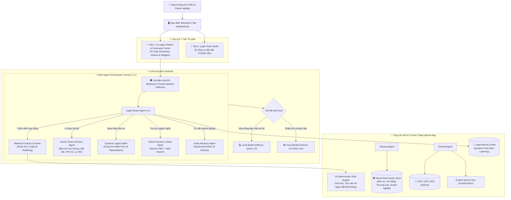

# ⚖️ LegalTech Platform
### Hệ thống Luật sư AI Trực tuyến & Studio Công cụ Pháp lý Toàn năng • Phiên bản 2.1 (The AI Lawyer & Studio Platform)

[-brightgreen.svg)](#quản-lý-phiên-bản--lộ-trình-versioning--roadmap)
[](https://opensource.org/licenses/MIT)
[](https://www.python.org/)
[-FF4B4B.svg)](https://streamlit.io/)
[](https://ollama.ai/)
[](https://aistudio.google.com/)

---

## 📜 NGUYÊN TẮC HOẠT ĐỘNG DỰ ÁN (PROJECT RULES)
> 🚨 **QUY ĐỊNH BẮT BUỘC:** Mọi tác vụ phát triển của AI hoặc người đóng góp phải tuân thủ nghiêm ngặt tài liệu:  
> 👉 **[`RULES.md`](./RULES.md)** *(Quy chuẩn đọc đầu tiên, quy tắc đặt tên version preview/requirements và an toàn bảo mật).*

---

## 🚀 QUẢN LÝ PHIÊN BẢN & LỘ TRÌNH (VERSIONING & ROADMAP)

* **Yêu cầu Kỹ thuật Phiên bản 1.0 (Requirements Version 1.0):**
  * Đặc tả 7 tiêu chí chấm điểm ban đầu của giảng viên: [`requirements/requirements_version_1.md`](./requirements/requirements_version_1.md).
* **Đánh giá Phiên bản 1.0 (Preview Version 1):**
  * Tổng hợp nhận xét người dùng & phản biện kỹ thuật sơ khởi: [`requirements/preview_version_1.md`](./requirements/preview_version_1.md).
* **Yêu cầu Kỹ thuật Phiên bản 1.1 (Requirements Version 1.1) - [ĐÃ HOÀN THÀNH]:**
  * 4 nâng cấp thực chiến: Link kiểm chứng Cổng TT Chính phủ, Bộ tạo hồ sơ doanh nghiệp (.docx), Tra cứu Hybrid (CSDL + Web Search), Trực quan hóa PII: [`requirements/requirements_version_1.1.md`](./requirements/requirements_version_1.1.md).
* **Đánh giá Phiên bản 1.1 (Preview Version 1.1):**
  * Đánh giá v1.1, phân tích yêu cầu Tool Thẩm định Lỗ hổng Hợp đồng, In-Chat Generative UI, mở rộng phạm vi toàn bộ văn bản cho cá nhân/doanh nghiệp, và phản biện chuyên sâu: [`requirements/preview_version_1.1.md`](./requirements/preview_version_1.1.md).
* **Yêu cầu Kỹ thuật Phiên bản 2.0 (Requirements Version 2.0 - Major Release) - [ĐÃ HOÀN THÀNH 100%]:**
  * Đại tu toàn diện kiến trúc: Quét cạm bẫy hợp đồng, chấm điểm rủi ro pháp lý (0-100), In-Chat Interactive Canvas, Hierarchical RAG Đa luật: [`requirements/requirements_version_2.0.md`](./requirements/requirements_version_2.0.md).
* **Đánh giá Phiên bản 2.0 (Preview Version 2.0):**
  * Đánh giá v2.0, phân tích yêu cầu "Luật sư Online phân tích 2 chiều đối kháng", giải quyết 4 case xã hội, soạn thảo văn bản on-demand và tái cấu trúc thành 2 Tab NotebookLM: [`requirements/preview_version_2.0.md`](./requirements/preview_version_2.0.md).
* **Yêu cầu Kỹ thuật Phiên bản 2.1 (Requirements Version 2.1) - [ĐÃ HOÀN THÀNH 100%]:**
  * The Legal AI Lawyer & Studio Platform: Phân tích hợp đồng 2 chiều đối kháng, 4 case đời sống xã hội, Smart Pre-filled Form with Placeholder Fallback và giao diện 2 Tab NotebookLM: [`requirements/requirements_version_2.1.md`](./requirements/requirements_version_2.1.md).
  * Hướng dẫn chạy và kịch bản test chi tiết: [`tutorial/run_guide_version_2.1.md`](./tutorial/run_guide_version_2.1.md).

---

## 🌟 ĐỘT PHÁ CÔNG NGHỆ TRONG PHIÊN BẢN 2.1 (THE AI LAWYER & STUDIO)

1. ⚖️ **Phân tích Hợp đồng 2 Chiều Đối kháng (Bilateral Exploitation Analysis):**
   - Đóng vai trò Vị Luật sư Trực tuyến bóc tách toàn diện 2 góc nhìn:
     - 🔴 **Bên ra luật (Bên mạnh thế/soạn thảo):** Có thể lợi dụng kẽ hở nào để trì hoãn nghĩa vụ, áp phạt nặng hoặc né tránh bồi thường.
     - 🟡 **Bên theo luật (Bên yếu thế/ký kết):** Có thể bị dính bẫy gì, hoặc có thể vận dụng điều luật nào để phản tố, vô hiệu hóa điều khoản bất lợi.
   - Trực quan hóa qua **Ma trận Đối kháng (Bilateral Matrix)** và đề xuất điều khoản dung hòa (Neutral Clause Redline), xuất báo cáo Word (.docx).
2. 🏛️ **Cơ sở Tri thức & Kịch bản 4 Case Đời sống Xã hội Phức tạp:**
   - **Case 1 (Bạo lực học đường):** Điều 599 BLDS 2015 quy định trách nhiệm bồi thường của nhà trường; NĐ 80/2017/NĐ-CP; quy trình giám định thương tích và đơn khiếu nại.
   - **Case 2 (Tranh chấp ranh giới Sổ đỏ):** Điều 202 Luật Đất đai (thủ tục hòa giải bắt buộc tại UBND cấp xã), Điều 175, 176 BLDS 2015 về mốc giới.
   - **Case 3 (Đòi nợ khi con nợ bỏ trốn):** Điều 463 BLDS 2015; Điều 39, 40 BLTTDS (TAND nơi cư trú cuối cùng, niêm yết xét xử vắng mặt); Điều 175 BLHS.
   - **Case 4 (Ly hôn, nuôi con & tài sản):** Điều 55, 59, 81 Luật HN&GĐ 2014 (con dưới 36 tháng ưu tiên mẹ, con từ đủ 7 tuổi phải hỏi ý kiến).
3. 📝 **Engine Soạn thảo Văn bản Pháp lý Đa dạng theo Form Thông minh (Smart Pre-filled Form with Flexible Placeholders):**
   - AI tự động **điền sẵn 100% căn cứ pháp luật và nội dung tranh tụng chuẩn mực**.
   - Các trường thông tin cá nhân: người dùng nhập thì nhận, **nếu để trống hoặc chưa biết thì AI tự động chèn dòng chấm giữ chỗ `........................`** để tải về in ra điền tay hoặc ký tên.
   - Hỗ trợ mọi loại đơn: Đơn khởi kiện đòi nợ, Đơn hòa giải đất đai, Đơn khiếu nại trường học, Đơn thuận tình ly hôn, Hợp đồng dịch vụ cân bằng, Hồ sơ ĐKDN theo NĐ 01/2021, và Văn bản tự do theo yêu cầu qua AI.
4. 💻 **Trải nghiệm 2 Tab Tối giản (The 2-Tab NotebookLM Experience):**
   - **Tab 1: 💬 AI Legal Chatbot & Command Center:** Tích hợp tất cả các tool, triệu hồi Interactive Widget trực tiếp trong bong bóng chat theo lệnh text.
   - **Tab 2: 🧰 Legal Tools Studio:** Trưng bày dạng dashboard toàn bộ 8 công cụ của hệ thống để chạy độc lập.

---

## 🏛️ 3. Kiến trúc Hệ thống Version 2.1 (System Architecture)



---

## 📂 4. Cấu trúc Thư mục Dự án

```
LLM_Nhut/
├── app/
│   └── main.py                  # Giao diện Streamlit 2 Tab chuẩn NotebookLM (AI Chatbot & Tools Studio)
├── data/
│   ├── chromadb/                # CSDL Vector (Index lưu trữ 53 chunks đa luật)
│   ├── database/                # CSDL SQLite (schema.sql & sme_legal.db) + legal_memory_bank.json
│   ├── evaluation/              # Dataset benchmark (benchmark_dataset.json)
│   └── raw_documents/           # 8 bộ luật nguồn (Dân sự, Lao động, Thương mại, Doanh nghiệp, Đất đai, Hôn nhân gia đình...)
├── llm_provider/                # Module Cloud & Local LLM Provider
│   ├── cloud_provider.py        # Tích hợp Google Gemini API
│   ├── local_provider.py        # Tích hợp Ollama Local API
│   └── model_factory.py         # Factory Switcher & Auto-fallback
├── reports/                     # Báo cáo và kết quả đo lường
│   ├── evaluation_results.csv   # Kết quả benchmark Ragas chi tiết
│   ├── model_comparison_report.md # Báo cáo so sánh Cloud vs Local
│   ├── presentation_slides.md   # Slide thuyết trình báo cáo đồ án
│   └── PROJECT_REPORT.md        # Báo cáo đồ án hoàn chỉnh 8 chương
├── requirements/                # Quản lý yêu cầu & Phiên bản (Quy chuẩn RULES.md)
│   ├── preview_version_1.md     # Đánh giá Version 1.0 & Phản biện kỹ thuật
│   ├── requirements_version_1.md # 7 tiêu chí chấm điểm Version 1.0
│   ├── preview_version_1.1.md   # Đánh giá Version 1.1 & Phản biện Continual Learning
│   ├── requirements_version_1.1.md # Yêu cầu kỹ thuật Version 1.1
│   ├── preview_version_2.0.md   # Đánh giá Version 2.0 (Luật sư 2 chiều & 4 case xã hội)
│   ├── requirements_version_2.0.md # Yêu cầu kỹ thuật Version 2.0 (Major Release)
│   └── requirements_version_2.1.md # Yêu cầu kỹ thuật Version 2.1 (The AI Lawyer & Studio)
├── src/
│   ├── agents/                  # Multi-Agent Workflow (Router, Advisory, Lookup, Reviewer, MemoryStore, Graph)
│   ├── database/                # Quản lý truy vấn SQLite (db_manager.py)
│   ├── dossier/                 # Tạo lập hồ sơ doanh nghiệp & Soạn thảo văn bản thông minh (dynamic_drafter.py)
│   ├── evaluation/              # Framework đánh giá Ragas (ragas_evaluator.py)
│   ├── rag/                     # Hierarchical RAG (embeddings, ingestion, retriever, vector_store)
│   ├── security/                # Guardrails (pii_masker, prompt_injection, moderator)
│   └── tools/                   # Web search tool, Contract scanner, Social cases knowledge
└── tutorial/                    # Hướng dẫn kiểm thử thực tế (run_guide_version_2.1.md)
├── .env.example                 # Template cấu hình biến môi trường
├── .gitignore                   # Loại trừ cache, venv, .env
├── LICENSE                      # Giấy phép MIT
├── README.md                    # Tài liệu tổng quan dự án
└── RULES.md                     # Quy định hoạt động bắt buộc cho AI
```

---

## 🚀 5. Hướng dẫn Khởi chạy Nhanh

Xem hướng dẫn chi tiết từng bước & bộ test cases tại:  
👉 **[`tutorial/run_guide_version_2.0.md`](./tutorial/run_guide_version_2.0.md)** *(Hướng dẫn & Test Cases thực chiến cho Version 2.0)*  
👉 **[`tutorial/run_guide.md`](./tutorial/run_guide.md)** *(Hướng dẫn nền tảng các phiên bản trước)*

```bash
# 1. Kích hoạt môi trường ảo
.\venv\Scripts\Activate.ps1

# 2. Khởi tạo CSDL SQLite (nếu chưa chạy)
python src/database/init_db.py

# 3. Khởi chạy giao diện web Streamlit (Version 2.0)
streamlit run app/main.py
```
Mở trình duyệt tại: `http://localhost:8501`.